## About

I'm a third-year B.Tech student in Computer Science and Engineering (AI & ML) at Kalaignar Karunanidhi Institute of Technology, Coimbatore. I'm building strong foundations in computer science while exploring machine learning, software engineering and research, and I like turning ideas into working software. I also enjoy the communication side of technology: coordinating students, speaking, and collaborating on teams.

## Experience & Highlights

- **Student leadership:** represented 60+ students as Student Representative in my first year, and helped coordinate freshers and student activities. [[CONFIRM: exact role title and dates]]
- **Communication:** welcomed Japanese guests in their native language during an institutional MOU visit; delivered a welcome address at a college hackathon; conducted a Student Companionship session. [[CONFIRM: wording and dates]]
- **Internships:** full-stack development at Thiranex; cloud computing (AWS) at DecodeLabs. [[CONFIRM: durations and what you built]]
- **Hackathons:** [[CONFIRM: list only what you took part in, with stage reached]]
- **Certifications:** [[CONFIRM: from resume]]

## Selected Projects

**Human Activity Recognition: label-noise research**
*Uniform, Transition-Boundary and Adjacent-Class Label Noise in Wearable Human Activity Recognition: A Controlled Subject-Wise Comparison.* Controlled label-noise experiments on UCI-HAR and PAMAP2 with subject-wise evaluation. Status: [[CONFIRM: e.g. "manuscript in preparation"]]. Repo: [[LINK]]

**Semantic Search Application**
Sentence embeddings (all-MiniLM-L6-v2) with FAISS similarity search, BM25 hybrid retrieval and a FastAPI backend. [[CONFIRM: React/Vite frontend implemented?]] Repo: [[LINK]]

**Student Portal**
Express.js and SQLite app with bcryptjs and JWT authentication and admin/viewer roles. Repo: [[LINK]]

## Technical Skills

| Area | Tools |
|---|---|
| Languages | [[CONFIRM: e.g. Python, C++, JavaScript]] |
| AI & ML | [[CONFIRM: e.g. PyTorch/TensorFlow, scikit-learn, FAISS, sentence-transformers]] |
| Frontend | [[CONFIRM: e.g. React, Vite]] |
| Backend | FastAPI, Express.js |
| Databases | SQLite [[+ others?]] |
| Tools | Git, GitHub, AWS [[CONFIRM]] |
| Research & Data | UCI-HAR, PAMAP2 [[CONFIRM: NumPy, pandas...]] |

## Contribution Activity

## Links

[GitHub](https://github.com/RathiVarshiniR) · [LinkedIn]([[URL]]) · [Portfolio]([[URL]])

